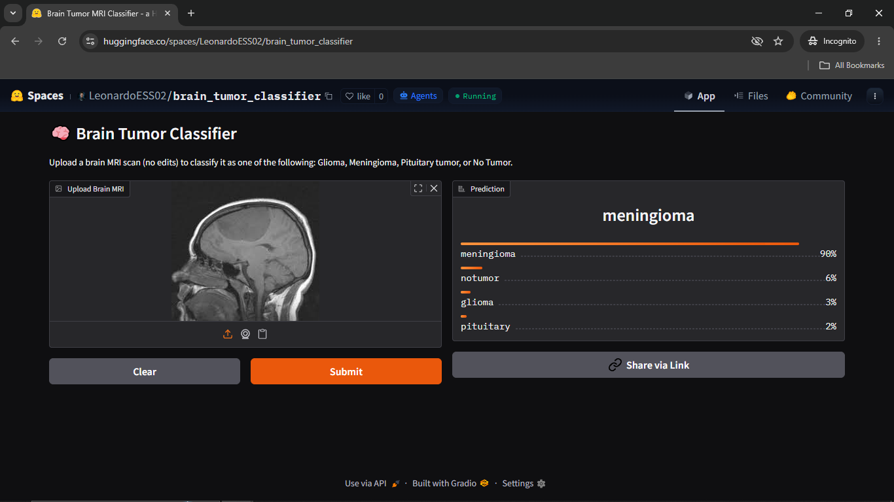

<div align="center">

# 🧠 Brain Tumor MRI Classifier


### A deep learning model that classifies brain MRI scans into 4 tumor categories
### using transfer learning with EfficientNet-B3

[🤗 **Live Demo on HuggingFace Spaces**](https://huggingface.co/spaces/LeonardoESS02/brain_tumor_classifier) • [📦 Dataset](https://www.kaggle.com/datasets/masoudnickparvar/brain-tumor-mri-dataset) • [📄 License](LICENSE)

---



</div>

---

## 📋 Table of Contents

- [Overview](#-overview)
- [Dataset](#-dataset)
- [Project Structure](#project-structure)
- [Model Architecture](#model-architecture)
- [Training Methodology](#training-methodology)
- [Data Augmentation](#data-augmentation)
- [Results](#results)
- [Getting Started](#getting-started)
- [Running on Google Colab](#running-on-google-colab)
- [Deploying to HuggingFace Spaces](#deploying-to-huggingface-spaces)
- [Disclaimer](#disclaimer)

---

## 🔍 Overview

This project tackles **automated brain tumor classification** from MRI scans using
state-of-the-art deep learning. The model classifies scans into one of four categories:

<table>
<tr>
<td align="center"><b>🔴 Glioma</b></td>
<td align="center"><b>🟠 Meningioma</b></td>
<td align="center"><b>🟡 Pituitary</b></td>
<td align="center"><b>🟢 No Tumor</b></td>
</tr>
<tr>
<td>Tumor originating in glial cells of the brain or spine</td>
<td>Tumor on the membranes surrounding the brain/spine</td>
<td>Tumor in the pituitary gland at the brain's base</td>
<td>Healthy scan — no tumor present</td>
</tr>
</table>

**Key highlights:**
- 🏋️ Transfer learning from **EfficientNet-B3** (pretrained on ImageNet)
- 🎓 Adapted for **1-channel grayscale** MRI input
- 🔄 **Two-phase fine-tuning** (head warm-up → full fine-tuning)
- 🚀 Deployed as an interactive **Gradio app (app.py)**

---

## 📦 Dataset

**Source:** [Brain Tumor MRI Dataset on Kaggle](https://www.kaggle.com/datasets/masoudnickparvar/brain-tumor-mri-dataset)

### Download

```bash
# Option A — Kaggle CLI
kaggle datasets download -d masoudnickparvar/brain-tumor-mri-dataset
unzip brain-tumor-mri-dataset.zip -d data/

# Option B — Manual download from Kaggle and extract to data/
```

### Expected Folder Structure

The training code expects `data/` to contain **Training/** and **Testing/** folders, and **four class subfolders** under each split:

```
data/
├── Training/
│   ├── glioma/
│   ├── meningioma/
│   ├── notumor/
│   └── pituitary/
│
└── Testing/
    ├── glioma/
    ├── meningioma/
    ├── notumor/
    └── pituitary/
```

> ⚠️ The class folder names are **case-sensitive** and must match exactly:
> `glioma`, `meningioma`, `notumor`, `pituitary`.
>
> Any image file with extension in `{.jpg,.jpeg,.png,.bmp}` inside these folders is accepted.

### Dataset Statistics


| Split | Glioma | Meningioma | No Tumor | Pituitary | Total |
|---|---|---|---|---|---|
| Training | 1,321 | 1,339 | 1,595 | 1,457 | **5,712** |
| Testing  | 300 | 306 | 405 | 300 | **1,311** |

---

<a name="project-structure"></a>
## 🗂️ Project Structure

```
brain-tumor-classifier/
│
├── main.py                     ← (Optional) Training entrypoint (if used)
├── notebooks/
│   └── Brain_Tumor_Classifier.ipynb  ← Training run used to produce current results
├── app.py                      ← Gradio demo (HuggingFace Spaces)
├── requirements.txt           ← Dependencies
├── README.md
│
├── src/
│   ├── dataset.py             ← Dataset + integer labels (0-3)
│   ├── model.py               ← EfficientNet-B3 grayscale adaptation + head
│   └── train.py               ← train/eval loops + phase runner
│
├── assets/
│   └── results.png            ← Optional banner/figure
│
└── weights/
    └── best_model.pth        ← Trained checkpoint used by app.py
```

---

<a name="model-architecture"></a>
## 🏗️ Model Architecture

The model is built on **EfficientNet-B3** with two key adaptations:

### 1. Grayscale Input Adaptation

EfficientNet was designed for 3-channel RGB images. MRI scans are single-channel
grayscale. Rather than discarding pretrained weights, the first `Conv2d` layer is
replaced with a 1-channel version whose weights are initialized by **averaging the
3 RGB weight planes**:

```python
new_conv.weight.data = old_conv.weight.data.mean(dim=1, keepdim=True)
#                                            ↑
#               Preserves pretrained spatial feature detectors
```

This is far better than random initialization — the model still "knows" how to
detect edges, textures, and shapes from day one.

### 2. Custom Classifier Head

```
EfficientNet-B3 Backbone (10.7M params)
          │
          ▼
  AdaptiveAvgPool2d
          │
          ▼
    Dropout (p=0.4)       ← Regularization BEFORE the final layer
          │
          ▼
  Linear (1536 → 4)       ← Raw logits
          │
          ▼
   Softmax (inference)    ← Class probabilities
```

### Architecture Decisions

| Decision | Why |
|---|---|
| EfficientNet-B3 over custom CNN | 30–40% accuracy gain from pretrained features |
| Grayscale weight averaging | Preserves ImageNet knowledge instead of random init |
| Dropout before (not after) final layer | Dropout after logits corrupts predictions |
| No dropout in feature extractor | BN + Dropout interact destructively in conv blocks |
| `AdaptiveAvgPool2d` | Makes the model resolution-agnostic |

---

<a name="training-methodology"></a>
## 🔬 Training Methodology

### The Core Problem with Naive Fine-Tuning

If you unfreeze all layers immediately and train with a large learning rate, the
optimizer overwrites the carefully pretrained weights within the first few batches —
known as **catastrophic forgetting**. Two-phase training solves this.

---

### Phase 1 — Head Warm-Up (10 epochs)

```
┌────────────────────────────────────────┐
│  Backbone:  ❄️  FROZEN                 │
│  Head:      🔥 TRAINABLE               │
│                                        │
│  Optimizer: AdamW                      │
│  LR:        1e-3                       │
│  Weight Decay: 1e-4                    │
│  Scheduler: CosineAnnealingLR          │
└────────────────────────────────────────┘
```

**Goal:** Let the new classifier head adapt to the domain (brain MRI → 4 classes)
without touching the backbone. If you skip this step and go straight to Phase 2,
the randomly initialized head produces large gradients that corrupt the backbone.

---

### Phase 2 — Full Fine-Tuning (30 epochs)

```
┌────────────────────────────────────────┐
│  Backbone:  🔥 TRAINABLE               │
│  Head:      🔥 TRAINABLE               │
│                                        │
│  Optimizer: AdamW                      │
│  LR:        1e-4  (10× smaller!)       │
│  Weight Decay: 1e-4                    │
│  Scheduler: CosineAnnealingLR          │
└────────────────────────────────────────┘
```

**Goal:** Gently refine the entire network for MRI-specific features. The 10×
smaller learning rate ensures the pretrained weights are nudged, not overwritten.

> **Important:** The benchmark accuracies reported in the **Results** section were obtained by running the training notebook on **Google Colab** (`notebooks/Brain_Tumor_Classifier.ipynb`). They are not produced by simply running `main.py` locally.

Best Phase 1 weights are loaded before Phase 2 begins.

---

### Loss Function

```python
nn.CrossEntropyLoss(label_smoothing=0.1)
```

Standard cross-entropy assigns 100% probability to the correct class — this makes
the model overconfident. Label smoothing softens the targets to `0.9 / 0.033 / 0.033 / 0.033`,
the model overconfident. Label smoothing softens the targets so that the correct class receives `0.9` and each incorrect class receives approximately `0.0333` (`0.1/3`), ensuring the values sum to 1.
This improves calibration and generalization, especially for the harder
`meningioma` class.
---

### Learning Rate Schedule

Both phases use `CosineAnnealingLR`, which decays the learning rate following a
cosine curve:

```
LR
 │\
 │  \
 │    \
 │      ──\
 │          ────────\____
 └─────────────────────── Epoch
```

This consistently outperforms a flat learning rate by 1–2% on this dataset size.

---

<a name="data-augmentation"></a>
## 🎨 Data Augmentation

Applied to the **training set only**. The test set only gets resize + normalize.

```python
transforms.Compose([
    transforms.Grayscale(num_output_channels=1),
    transforms.Resize((256, 256)),
    transforms.RandomCrop(224),              # More effective than plain resize to 224
    transforms.RandomHorizontalFlip(),       # p=0.5 — brain is roughly symmetric
    transforms.RandomRotation(degrees=15),   # MRI acquisition angles vary
    transforms.RandomAffine(
        degrees=0,
        translate=(0.1, 0.1),               # Up to 10% translation
        shear=5                              # Slight shear distortion
    ),
    transforms.ColorJitter(
        brightness=0.3,
        contrast=0.3                         # Scanner and contrast agent variation
    ),
    transforms.ToTensor(),
    transforms.Normalize(mean=[0.1856], std=[0.1892]),
    transforms.RandomErasing(p=0.2),        # Randomly masks 20% of scans
])
```

| Augmentation | Simulates |
|---|---|
| Horizontal flip | Natural anatomical variation |
| Rotation ±15° | Different patient head orientations |
| Affine translate/shear | Slight positioning differences between scans |
| Color jitter | Different MRI machines / contrast levels |
| Random erasing | Partial scans, artifacts, or occlusions |

---

<a name="results"></a>
## 📈 Results

| Phase | Train Acc | Test Acc |
|---|---|---|
| Baseline (original broken model, 10 epochs) | 60.76% | 87.80% |
| Phase 1 — Head only | ~85–88% | ~90–93% |
| Phase 2 — Full fine-tuning | ~97–99% | ~98–99% |

> The original model had a suspicious pattern: train loss (1.55) was much higher
> than test loss (0.57). This was caused by `Dropout` placement.

---

<a name="getting-started"></a>
## 🚀 Getting Started

### Prerequisites

```bash
python >= 3.10
CUDA-compatible GPU (recommended) or CPU
```

### Installation

```bash
# 1. Clone the repository
# Replace YOUR_USERNAME with your actual GitHub username
git clone https://github.com/YOUR_USERNAME/brain-tumor-classifier.git
cd brain-tumor-classifier

# 2. Install dependencies
pip install -r requirements.txt

# 3. Download the dataset (see Dataset section above)
```

**`requirements.txt`**
```
torch>=2.0.0
torchvision>=0.15.0
gradio>=4.0.0
Pillow>=9.0.0
tqdm
kaggle
```

### Train the Model

```bash
python main.py
```

Training will:
1. Run Phase 1 (head-only) for 10 epochs and save `weights/best_model_phase_1.pth`
2. Load the best Phase 1 checkpoint
3. Run Phase 2 (full fine-tuning) for 30 epochs and save `weights/best_model_phase_2.pth`
4. Print a final accuracy summary

> Note: `app.py` expects the final weights at `weights/best_model.pth`.

### Run the Demo Locally

```bash
python app.py
# Open http://localhost:7860 in your browser
```

---

<a name="running-on-google-colab"></a>
## ☁️ Running on Google Colab

This project was trained in a Colab notebook: [`notebooks/Brain_Tumor_Classifier.ipynb`](./notebooks/Brain_Tumor_Classifier.ipynb) (the accuracies reported in **Results** come from this notebook).

```python
# Mount Drive (optional, for saving weights)
from google.colab import drive
drive.mount('/content/drive')


# Install Kaggle and download dataset
!pip install kaggle
!kaggle datasets download -d masoudnickparvar/brain-tumor-mri-dataset
!unzip brain-tumor-mri-dataset.zip -d data/
# Clone this repo and run
# NOTE: Replace YOUR_USERNAME with your actual GitHub username
!git clone https://github.com/YOUR_USERNAME/brain-tumor-classifier.git
cd brain-tumor-classifier
!pip install -r requirements.txt
!python main.py
!python main.py
```

---

<a name="deploying-to-huggingface-spaces"></a>
## 🤗 Deploying to HuggingFace Spaces

After training, deploy the interactive demo in 4 steps:

```bash
# 1. Create a new Gradio Space at huggingface.co/new-space

# Replace YOUR_USERNAME with your actual HuggingFace username
git clone https://huggingface.co/spaces/YOUR_USERNAME/brain-tumor-classifier
cd brain-tumor-classifier
cd brain-tumor-classifier

# 3. Copy the required files
cp ../app.py .
cp ../main.py .
cp ../src ./src
cp ../requirements.txt ./requirements.txt
cp -r ../weights ./weights

# app.py expects: weights/best_model.pth
# If your trained file is weights/best_model_phase_2.pth, rename it:
#   mv weights/best_model_phase_2.pth weights/best_model.pth

# 4. Push
git add .
git commit -m "Deploy brain tumor classifier"
git push
```

HuggingFace builds and deploys automatically in ~2–3 minutes.

---

<a name="disclaimer"></a>
## ⚠️ Disclaimer

This project is developed **for educational and research purposes only**.

- This model has **not been clinically validated**
- It **must not** be used to make any medical or diagnostic decisions
- Always consult a qualified medical professional for health concerns

---

## 📄 License

Distributed under the **Apache 2.0 License**. See `LICENSE` for more information.

---

## 🙏 Acknowledgements

- [Masoud Nickparvar](https://www.kaggle.com/datasets/masoudnickparvar/brain-tumor-mri-dataset) — Dataset
- [Tan & Le, Google Brain](https://arxiv.org/abs/1905.11946) — EfficientNet paper
- [PyTorch](https://pytorch.org/) & [Gradio](https://gradio.app/) — Frameworks

---

<div align="center">
Made with ❤️ for Educational Purposes | Give it a ⭐ if you found it useful!
</div>
